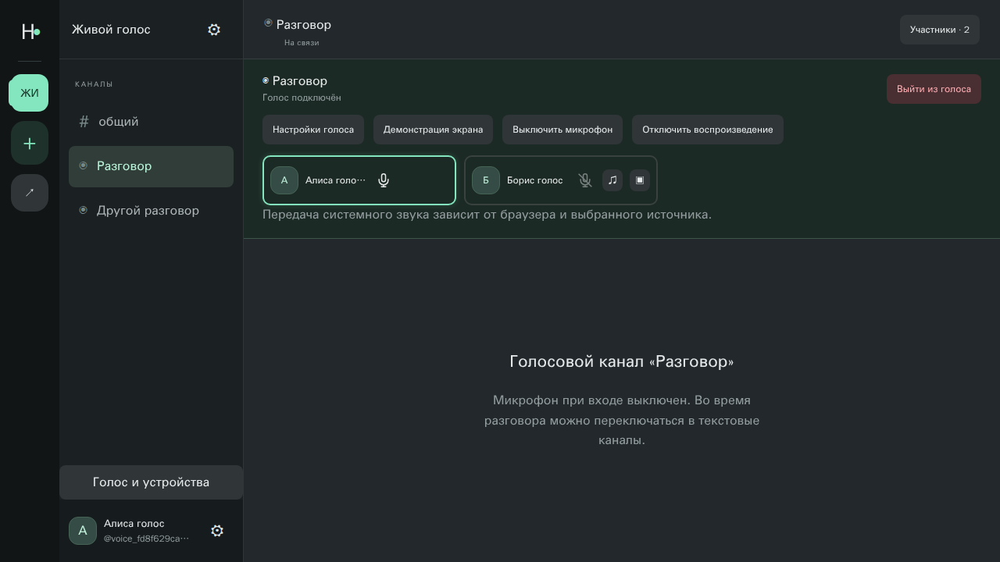
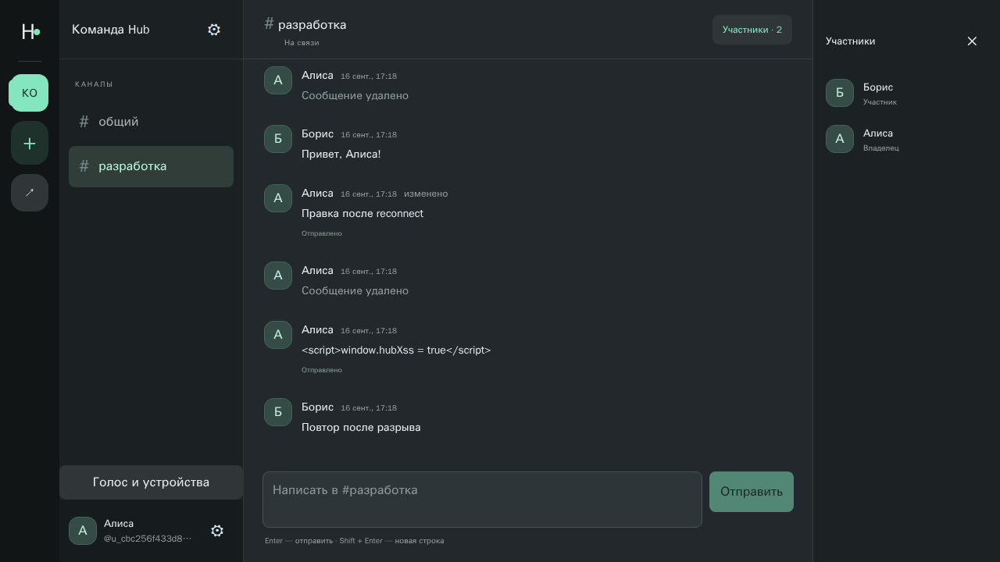
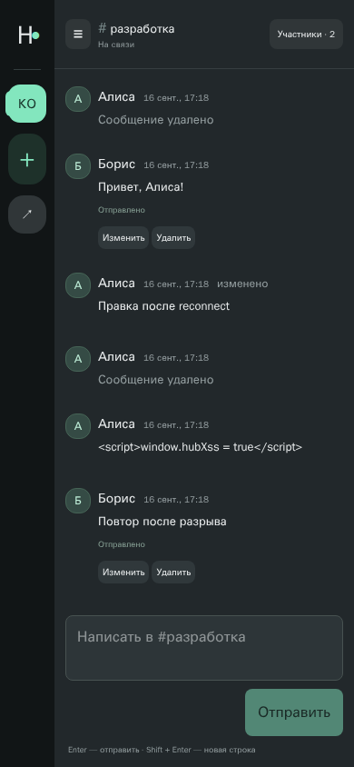
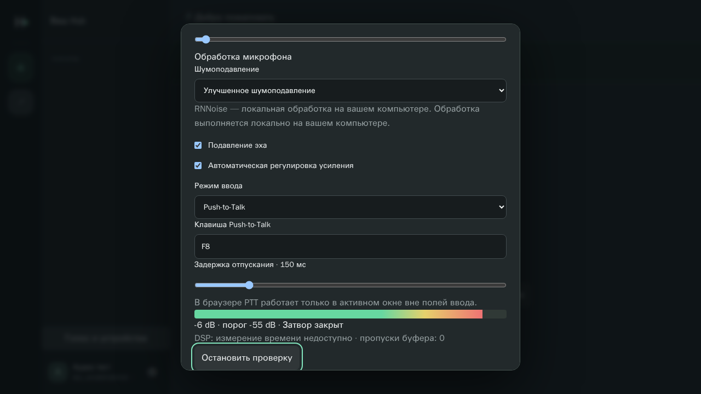

# Hub

Self-hosted сервис сообществ в духе Discord: текстовые каналы в реальном времени,
голосовые комнаты, демонстрация экрана и клиент для Windows.
Демо: **[hub.mrloic.ru](https://hub.mrloic.ru)** — развёрнуто на домашнем сервере и доступно не всегда.



## Возможности

- **Сообщества и роли** — владелец, совладелец, администратор, участник; матрица прав проверяется на сервере, передача владения транзакционная.
- **Приглашения** — ссылки-инвайты, сериализация вступления блокировкой строк в PostgreSQL.
- **Текстовые каналы** — история страницами по 50 сообщений, редактирование и удаление, мгновенные обновления через Socket.IO.
- **Голос** — self-hosted LiveKit (WebRTC SFU): индикатор речи, mute/deafen, переподключение, одна активная комната на аккаунт.
- **Демонстрация экрана** — трансляция через LiveKit с выбором источника в браузере.
- **Шумоподавление на клиенте** — RNNoise (WASM) в AudioWorklet, VAD, push-to-talk, усиление, громкость отдельных собеседников.
- **Windows-приложение** — Electron-клиент поверх того же React-интерфейса, трей, горячие клавиши, установщик NSIS.

## Стек

| Слой | Технологии |
| --- | --- |
| Фронтенд | React 19, TypeScript, Vite, Tailwind CSS |
| Бэкенд | Node.js 24, NestJS 12 (модульный монолит), Socket.IO, Zod |
| Данные | PostgreSQL, Prisma 7 с версионированными миграциями |
| Медиа | LiveKit (self-hosted SFU), TURN/TLS, RNNoise WASM |
| Десктоп | Electron |
| Инфраструктура | Docker Compose, Caddy (HTTPS, L4-маршрутизация по SNI, PROXY v2) |
| Тесты | node:test + tsx (unit, integration на реальной БД), Playwright (e2e) |

## Архитектура

```
Браузер / Electron
   │ HTTPS, WSS
   ▼
 Caddy ──► web (статика React)
   │   ──► api (NestJS) ──► PostgreSQL
   │             │
   │             └─ сигнализация LiveKit через api: сессия + Origin + JWT + проверка прав
   └─ TLS по SNI ──► LiveKit (TURN/TLS, UDP 7882)
```

Ключевые решения:

- **Все записи идут через HTTP**, Socket.IO рассылает только инвалидации без текста сообщений. Права проверяются в одном месте.
- **Сессии в PostgreSQL**: в cookie случайный токен, в БД — только его SHA-256. Пароли хешируются Argon2.
- **Медиатокены живут 60 секунд**, а сигнализация LiveKit проходит через бэкенд. Поэтому отозванный доступ (кик, выход, удаление канала) закрывается сразу, а не по истечении токена.
- **Без Redis и очередей** — один процесс API, ограничение частоты запросов в PostgreSQL.

Подробнее: [архитектура и права](docs/architecture.md), [безопасность](docs/security.md), [требования](docs/spec.md).

## Быстрый старт

Нужны Docker и Docker Compose.

```bash
git clone <url> hub && cd hub
docker run --rm --user "$(id -u):$(id -g)" -v "$PWD:/work" -w /work node:24.21.0-bookworm-slim node scripts/setup.mjs
docker compose build api web
docker compose up -d --wait db
docker compose run --rm migrate
docker compose up -d --wait api web
```

Откройте http://localhost:8080, зарегистрируйтесь и создайте сообщество.
`scripts/setup.mjs` генерирует `.env` со случайными секретами. Включение голоса, продакшен-режим,
бэкапы и Windows-клиент описаны в [руководстве по эксплуатации](docs/operations.md).

## Проверки

```bash
npm run lint
npm run typecheck
npm run test:unit
npm run test:integration   # изолированная БД в отдельном Compose-проекте
npm run test:e2e           # Playwright, два пользователя, чат и голос
```

## Скриншоты

| Чат | Мобильная версия | Настройки звука |
| --- | --- | --- |
|  |  |  |

## Статус

Готово: текст, голос, демонстрация экрана, роли, продакшен-развёртывание с TURN, бэкап и восстановление, Windows-клиент.
В планах: личные сообщения, реакции, ответы, файлы, аватары, мониторинг и нагрузочное тестирование. См. [план](docs/plan.md).
