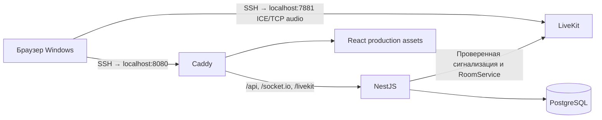
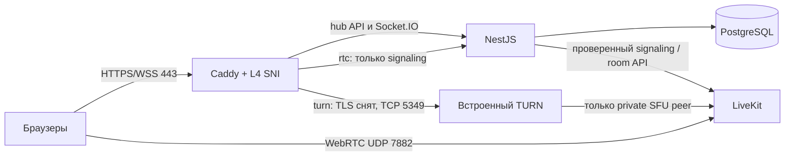

# Архитектура

Один API-процесс. AccountsModule, CommunitiesModule, ChatModule используют
CoreModule (БД, сессии, доступ, rate limiter, realtime). Redis не нужен.
Клиент Socket.IO использует WebSocket transport (Origin присутствует и проверяется),
без HTTP polling fallback. Socket.IO подключён к HTTP server Nest через injectable service, бизнес-записи
обрабатывают только HTTP controllers. PostgreSQL — источник истины для аккаунтов, доступа и текста; LiveKit сообщает
фактических участников и состояние медиапотоков.

## Модель
User: нормализованный уникальный логин, displayName, Argon2 hash.
Session: SHA-256 случайного 256-bit cookie, userId, expiresAt (7 суток).
Community → Membership (составной PK communityId/userId, роль), Channel, Invite.
Channel → Message (authorId/clientId UNIQUE, server sequence, время, deletedAt).
Invite: случайные 32 байта, срок, лимит/счётчик, отзыв. RateLimit: хеш ключа окна,
счётчик, время очистки. Индексы сообщений по channelId/sequence, членства по userId.
Миграция 2 усиливает ограничения: один OWNER, пустой текст удалённого сообщения,
неотрицательные uses в пределах maxUses.

## Транзакции
Access.inCommunity блокирует строку Community FOR UPDATE, проверяет членство
и держит блокировку до завершения операции. Это простой выбор для закрытого
малого сервиса: операции одного сообщества сериализуются, разные независимы.
Чтение истории также внутри этой проверки; неизвестный канал/сообщество не раскрывается.
Для channel повторно проверяется существование после захвата блокировки.
Приглашение: community → invite FOR UPDATE, повторная проверка срока/лимита/членства,
создание членства и increment uses в одной транзакции. Единый порядок блокировок.
Передача: бывший OWNER становится ADMIN, выбранный участник OWNER в том же commit.

## Авторизация и права
Сессия перечитывается из БД на каждом HTTP-запросе. Вход/регистрация выпускают новый
случайный cookie, удаляют предыдущую сессию и закрывают её sockets. Выход удаляет
строку и cookie. Cookie HttpOnly/SameSite=Strict, Secure в production.
CSRF: подписанный HMAC токен в HttpOnly cookie и заголовке X-Hub-CSRF, срок 7 дней,
плюс точное совпадение Origin с APP_URL. Это действует и до входа.

| Действие | OWNER | CO_OWNER | ADMIN | MEMBER |
| --- | --- | --- | --- | --- |
| Читать/писать; править своё | да | да | да | да |
| Удалять сообщения | все | свои, ADMIN/MEMBER | свои и MEMBER | свои |
| Название/каналы/приглашения | да | да | да | нет |
| Исключать | всех кроме OWNER | ADMIN/MEMBER | MEMBER | нет |
| Менять роли | CO_OWNER/ADMIN/MEMBER | ADMIN ↔ MEMBER | нет | нет |
| Передать владение/удалить сообщество | да | нет | нет | нет |
| Выйти | после передачи | да | да | да |

Собственную роль через PATCH менять нельзя. Только OWNER назначает/снимает
CO_OWNER. Совладельцев может быть несколько. Проверка выполняется сервером внутри
транзакции; UI использует ту же чистую permission matrix только для отображения.
Миграция `202609160004_co_owner` добавляет значение PostgreSQL enum без изменения строк.

## Синхронизация
`refresh` — персональная инвалидация без payload, рассылается текущим участникам
после commit, удалённому участнику — только сигнал очистить/перечитать доступ.
Перед отправкой проверяется сессия. Нет широковещательных комнат со старыми правами
и буфера событий для автоматического восстановления. `subscribe` проверяет БД,
не даёт права на получение данных и не выполняет записи; выбор сбрасывается
при инвалидации. UI получает свои инвалидации после handshake без обязательной подписки.
Срок соединения ограничен expiresAt; БД дополнительно сверяется каждые 15 секунд.

После reconnect/focus и каждые 5 секунд UI запрашивает список и активное сообщество,
а также актуальные страницы истории. Socket делает это сразу. Новая ревизия
отменяет применение старого HTTP-ответа; сервер сериализует операции сообщества.
Commit, случившийся после чтения, вызывает следующий refresh. Периодическая
сверка покрывает crash после commit до emit. Доставка не зависит от порядка emit;
в payload нет старого текста, который мог бы затереть новое состояние.
Событийного курсора нет, sequence используется только для keyset-пагинации истории.
При новой ревизии страницы перечитываются от верхней границы; deleted rows остаются
заглушками. Интерфейс удерживает видимый DOM-якорь или низ, если читатель уже внизу.
Память ограничена окном 20×50 сообщений; далее переход в более старое окно.
При смене окна можно вернуться к последним. Несохранённые сообщения и черновик
привязаны к user/channel в sessionStorage. Повтор использует тот же clientId.

## Источники API и версий
Проверены официальные [NestJS migration guide](https://docs.nestjs.com/migration-guide),
[Socket.IO server options](https://socket.io/docs/v4/server-options/),
[Prisma](https://www.prisma.io/docs), [Vite](https://vite.dev/guide/),
[Tailwind/Vite](https://tailwindcss.com/docs/installation/using-vite),
[Caddy handle](https://caddyserver.com/docs/caddyfile/directives/handle).
Точные версии — package.json/package-lock.json и Dockerfiles. Prisma закреплён
на stable 7, не на автоматически предлагаемом 8 RC. Overrides deepmerge-ts/mysql2
устраняют advisory в инструментах Prisma; MySQL в Hub не используется.

## Голос: дополнение этапа 2

VoiceService/VoiceController/VoiceGateway добавлены в модульный монолит. LiveKit —
отдельный SFU контейнер; текстовые записи и Socket.IO по-прежнему работают как раньше.
Channel.type=TEXT по умолчанию; только VOICE разрешён в `/api/voice/join`, TEXT chat
API отклоняет VOICE. Тип нельзя менять переименованием. LiveKit room — `hub_voice_<channel UUID>`.

POST join принимает только channelId, POST leave — leaseId. AuthGuard проверяет
сессию/CSRF, join ограничен 20/мин на пользователя. VoiceLease в PostgreSQL хранит
userId (PK), случайный id, channel/community/session, room, revoked. Блокировка
строки User сериализует смену голоса между вкладками и сообществами. Перед новой
lease прежний участник удаляется на SFU, старые signaling sockets закрываются.
Старая вкладка не может выполнить leave новой lease по устаревшему id.

JWT живёт 60 секунд для начального соединения; LiveKit обновляет его в сессии.
Identity = серверный userId, metadata = lease UUID, имя = displayName. Grants:
roomJoin, room=<серверное имя>, canSubscribe, canPublish, microphone + screen_share + screen_share_audio;
canPublishData=false, canUpdateOwnMetadata=false, без admin/create/list/record.
У self-hosted LiveKit истечение JWT не завершает уже установленный звонок и
RemoveParticipant само по себе не запрещает повторное использование прежнего токена.
Поэтому 7880 остаётся внутренним, а signaling проходит через VoiceGateway.

Шлюз разрешает только signaling GET `/livekit/rtc`, `/livekit/rtc/v1`
и соответствующие `/validate`; при WS требует
точный Origin. Проверяет Hub cookie/session, подпись JWT, identity, room, nonce lease,
членство, существующий VOICE channel и срок сессии. Token не заменяет Hub cookie.
Административные пути не проксируются. Cookies/URI запросов не логируются Caddy,
шлюз не печатает ошибки с URL. Секреты не импортируются frontend.

Revoke вызывается после logout/изменений сообщества; каждые 2 секунды reconciler
дополнительно сверяет leases с БД и реальных участников SFU. Удалённые сущности
не каскадируют VoiceLease: незавершённый отзыв сохраняется для повторной попытки.
При отказе SFU текстовая операция остаётся выполненной, отзыв повторяется, signaling
по утраченным правам уже запрещён. Сетевое разделение может задержать удаление
существующего медиапотока; это ограничение распределённой системы, не гарантия мгновенности.

React useVoice принадлежит аккаунту, а не Chat: выбор текста не пересоздаёт Room.
Состояния/список/активные говорящие поступают из LiveKit SDK; audio tracks attach к
медиаэлементам, deafen отключает их playback. Disconnect останавливает local tracks,
отсоединяет audio elements и отзывает lease. Камера запрещена grants. Экран передаётся по тому же медиатранспорту; новые порты не нужны.

Локально force_tcp, node_ip=127.0.0.1 и отдельный SSH forwarding 7881. Обычный HTTP
reverse proxy переносит signaling, но не ICE media. Автотест моделирует второй TCP
туннель внутри runner, без host network и без публикации тестовых портов.

При обычных текстовых сообщениях LiveKit API не вызывается. Синхронная сверка
голосового доступа выполняется после изменений сообщества/каналов, отдельно от
текстовых инвалидаций. Недоступность SFU не задерживает отправку сообщений.

## Production: границы сети и доверия

`compose.production.yaml` — отдельный файл, тот же проект hub и external
hub_postgres-data; local/test не получают публичных портов. Один API и один SFU,
Redis не требуется. data-сеть internal (db/api); front (web/api); media (web/api/SFU).
SFU имеет фиксированный **внутренний** 172.30.224.10; внешний IPv4 подставляется
в игнорируемый `.runtime/production/livekit.yaml`. Конфликт подсетей проверяется до запуска. Динамические Docker-адреса выделяются
только из 172.30.224.128/25, чтобы не занять статические адреса Caddy/SFU.

CaddyL4 v2.11.3 зафиксирован digest; это сборка LiveKit с модулем caddy-l4, а не
стандартный Caddy binary. Listener wrapper пропускает обычный HTTPS в HTTP app
без дополнительного proxy-hop, сохраняя адрес клиента; SNI turn.mrloic.ru
терминирует TLS и направляет в закрытый 5349 с PROXY protocol v2. LiveKit принимает этот заголовок
только от Caddy 172.30.224.2/32, сохраняя адрес клиента для TURN (в том числе Firefox). Сертификаты трёх имён управляются
Caddy HTTP-01, /data постоянен. ACME TLS-ALPN отключён, чтобы не конфликтовать с TURN.
HTTP/3 выключен: UDP 443 не нужен. 80 нужен для HTTP-01 и redirects.

API сохраняет `trust proxy=false`, не вычисляет HTTPS по X-Forwarded-Proto:
production требует фиксированный HTTPS APP_URL и всегда Secure cookie.
Caddy заменяет X-Hub-Proxy и X-Hub-Client-IP. API принимает IP для rate limiting
только при constant-time проверке отдельного PROXY_SECRET; иначе использует peer.
Секрет не попадает в frontend, access/debug logs выключены. API host port отсутствует.

Host-only cookie Hub не отправляется на rtc. Выдача token остаётся same-origin
HTTP с CSRF и сессией. Production signaling использует краткоживущий bearer JWT,
точный Origin Hub, проверку подписи/sub/nonce/room и актуальной VoiceLease, включая
её DB-сессию/expiry, членство и канал. Local/test дополнительно требуют cookie
как прежде. Это не обход авторизации: имя комнаты формирует backend, а отозванный
токен не проходит DB-проверку даже до своего exp. Refresh JWT от SFU также проходит
шлюз. HTTP validate разрешает CORS только Hub, без credentials/wildcard.

TURN получает временные credentials от SFU, клиент теперь использует эти ICE-серверы.
TURN/TLS доступен только через Caddy; анонимный STUN binding допустим, allocation
требует аутентификации. TTL credentials 300 секунд, максимум 4 allocations на
участника. Peer ACL разрешает только 172.30.224.10/32, запрещает остальные IPv4/IPv6:
relay не служит прокси в LAN/Internet даже для зарегистрированного участника.
Relay-порты 30000–30199 внутри SFU, наружу не публикуются. Private ICE-кандидат
сохраняется для внутреннего TURN → SFU; direct-клиенты используют public candidate.
Изолированный forced-relay e2e проверяет эту схему без hairpin NAT и публичных relay-портов.
При изменении подсети ACL и тест должны меняться согласованно.

TLS/DTLS-SRTP — транспортное шифрование, не E2EE. Регистрация пока открыта и не имеет
email/recovery; нагрузочная устойчивость и внешний сетевой путь требуют отдельных проверок.

## Интерфейс и медиа

Общий native dialog закрывается по Escape и завершённому клику вне его границ;
клик/перетаскивание из содержимого не закрывает его. Закрытие подтверждения отменяет
действие; focus возвращается инициатору. Нативный dialog сохраняет focus trap.

Обработка микрофона хранится в versioned localStorage `hub.audio.v2`, без токенов;
прежние три boolean из `hub.voice.processing` мигрируются. Capture constraints
фильтруются getSupportedConstraints, DSP выполняется в AudioWorklet. Смена
устройства/обработки перезапускает capture без выхода из комнаты. RNNoise локален;
Frontend Krisp не подключён. Подробная цепочка — audio-processing.md.

Карточки участников имеют фиксированную геометрию; speaking меняет только рамку
и тень, muted и reconnect подавляют устаревшую подсветку. Микрофон и экран имеют
отдельные постоянные места для иконок.

Room подключается с autoSubscribe=false: микрофоны подписываются всегда, видео и
звук экрана — только у выбранного участника. TrackPublished/Unpublished и
Subscribed/Unsubscribed обновляют список. Viewer attach/detach не останавливает
удалённую публикацию. Закрытие просмотра снимает подписку на экран и его звук.
LocalParticipant.setScreenShareEnabled использует браузерный selector, до 1080p/15fps,
2.5 Mbit/s на основное кодирование, simulcast/dynacast/adaptiveStream. Это профиль,
а не измеренная ёмкость сервера. Local preview muted; удалённый screen audio
подчиняется deafen. Disconnect останавливает локальные tracks; событие ended
из браузера снимает публикацию штатным SDK. Камера и data publish не разрешены.

Если applyConstraints принят, но getSettings показывает прежние параметры, Hub
перезапускает только захват микрофона через restartTrack, сохраняя комнату и публикацию.
Это может кратко прервать исходящий звук. Если браузер всё равно игнорирует настройку,
интерфейс сообщает об этом; неподдерживаемые поля не становятся обязательными.

## Windows и общий аудиотракт

`apps/desktop` — Electron main/preload, NSIS; `apps/web` остаётся единственным frontend.
Main выдаёт упакованные web assets через session HTTPS protocol handler для origin
hub.mrloic.ru; /api и Socket.IO сохраняют production transport, cookies и Origin.
Network forwarding использует session.fetch с bypassCustomProtocolHandlers и штатной
проверкой TLS. Backend/LiveKit не запускаются на ПК, server secrets не копируются.
IPC ограничен настройками, пользовательским выбором screen source, состоянием голоса
и уведомлением без текста сообщения. RNNoise/VAD/gain работают в AudioWorklet,
TrackProcessor адаптирует поток для прежнего LiveKit. Детали: audio-processing.md.
